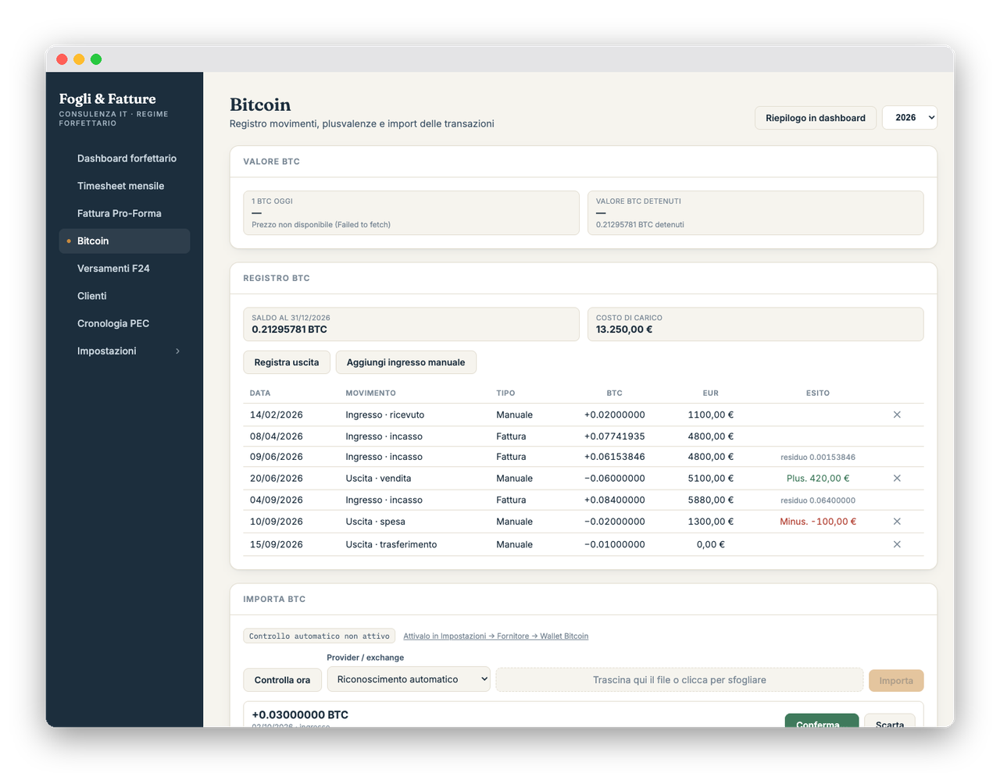
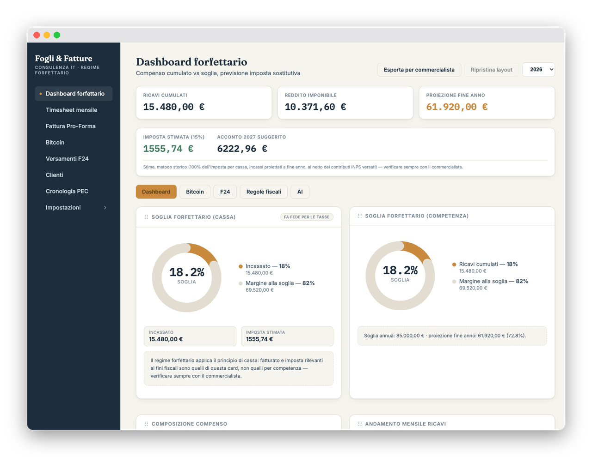
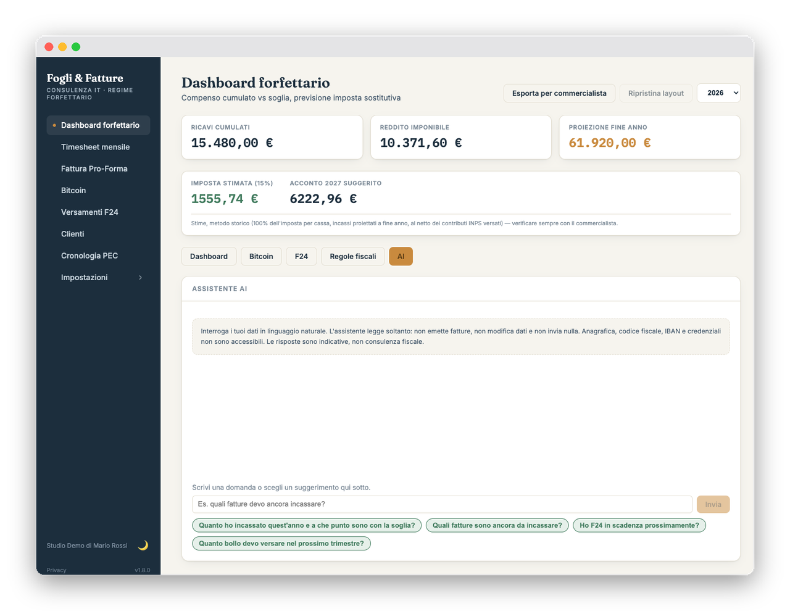
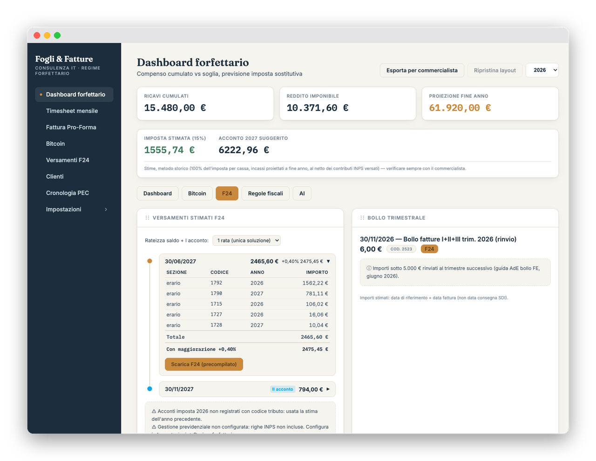
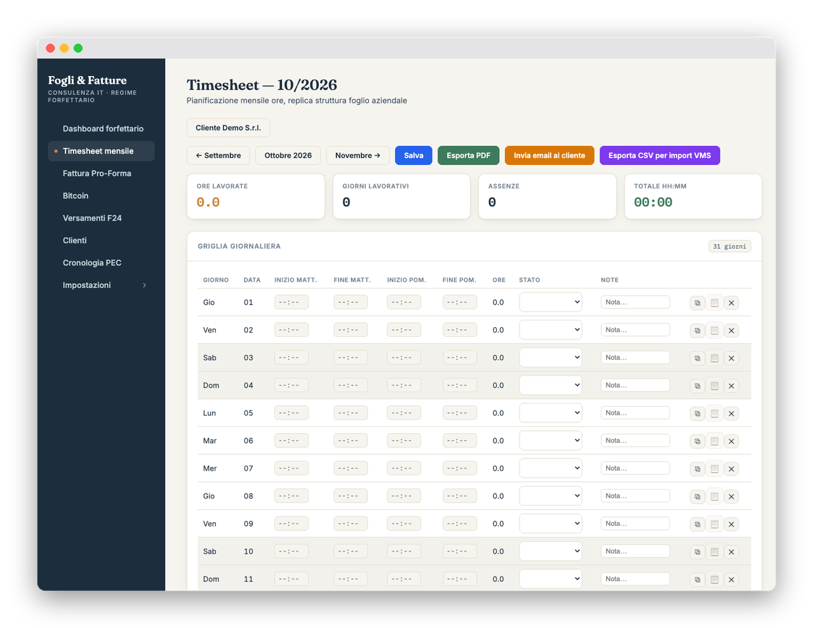
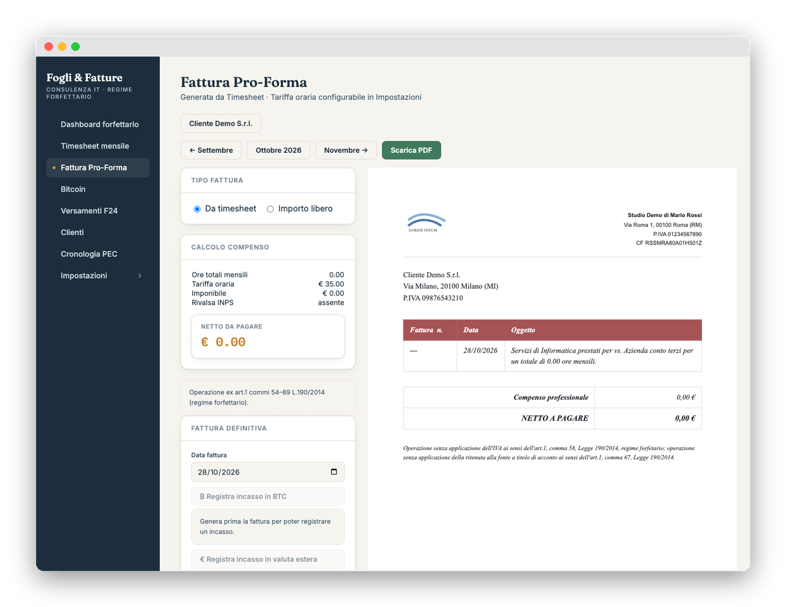

# Fogli & Fatture

[](LICENSE)
[](https://nodejs.org)


[](SECURITY.md)
[](https://github.com/priore/foglifatture/releases.atom)
[](CONTRIBUTING.md)
[](https://paypal.me/prioregroup)
[](https://github.com/priore/foglifatture#support-development)
[](https://star-history.com/#priore/foglifatture&Date)


App per chi lavora in regime forfettario, con due funzioni indipendenti:
- **Timesheet mensile** — registra le ore lavorate giorno per giorno, per uno o più clienti.
- **Fatturazione elettronica** — genera fatture calcolate da timesheet (ore × tariffa) oppure a importo e descrizione liberi, senza bisogno del timesheet.

Gira sul tuo computer: nessun dato va su internet, nessun abbonamento.

## Indice

- [Features](#features)
- [Sicurezza](#sicurezza)
- [Screenshot](#screenshot)
- [Installazione](#installazione)
- [Primo utilizzo](#primo-utilizzo)
- [Domande frequenti](#domande-frequenti)
- [Note per chi programma](#note-per-chi-programma)
- [Privacy](PRIVACY.md)
- [Licenza](#licenza)
- [Support Development](#support-development)

## Features

### Unico sul mercato forfettario italiano

- **Incasso fatture in Bitcoin** — nessun altro gestionale forfettario italiano noto lo offre.
  - Registra un incasso in BTC (datio in solutum) con TXID, cambio EUR/BTC applicato (fonte e ora) e indirizzo di destinazione.
  - Dati pronti per un eventuale controllo fiscale.
  - Dicitura opzionale in fattura/XML per i clienti abilitati.
  - Lettura opzionale dati transazione da blockchain e cambio storico.
  - Colonne dedicate nell'export per il commercialista.
- **AI applicata al regime forfettario**
  - Supporto AI per la gestione fiscale, con dati fiscali locali e aggregati, senza inviare dati sensibili a provider esterni.
  - Spiegazioni in linguaggio semplice dei requisiti dell'aliquota agevolata 5% e dell'art. 7-septies per clienti extra-UE.
  - "Spiega con AI" sulle variazioni delle regole fiscali anno su anno.
  - "Suggerisci ordine con AI" per l'utilizzo dei crediti F24 con motivazione.
  - Scadenze fiscali: calcolo locale, AI solo per casi particolari come le proroghe.
  - Importi e codici tributo partono verso l'AI solo dopo consenso esplicito (per richiesta o permanente in Impostazioni → AI).
- **Chat AI in dashboard** (tab «AI»):
  - Interroga i tuoi dati in linguaggio naturale senza uscire dall'app, con domande suggerite pronte da cliccare.
  - Legge gli stessi aggregati del server MCP; sola lettura, mai anagrafica, codice fiscale, IBAN o segreti.
  - Chiede il consenso prima di inviare dati fiscali al provider AI (per richiesta o permanente).
- **Server MCP in sola lettura**:
  - Interroga i tuoi dati fiscali da Claude Desktop, Claude Code, ChatGPT o Gemini in linguaggio naturale.
  - Espone solo aggregati: riepilogo anno, scadenze, F24, bollo trimestrale, crediti, elenco fatture, regole fiscali.
  - Mai anagrafica, codice fiscale, IBAN o segreti; non può emettere fatture né inviare PEC.
  - Disattivato di default: si abilita in Impostazioni → AI, con comandi di configurazione pronti da incollare.
- **Router AI a cascata**
  1. Gemini API
  2. Google Antigravity CLI
  3. GitHub Copilot CLI
  4. Claude API
  5. Groq API
  6. LLM locale (Ollama/LM Studio)

### Timesheet

- **Timesheet multi-cliente** — ore giornaliere per cliente, con tariffa oraria propria per ciascuno.
- **Promemoria fine mese** — notifica opzionale per non dimenticare di compilare il timesheet.
- **Import storico** — importazione di timesheet pregressi (XLS) e fatture già emesse (XML FatturaPA), per partire senza perdere lo storico.

### Fatturazione elettronica

- **Fatturazione elettronica FatturaPA** — XML conforme allo schema ufficiale, validato prima dell'invio.
  - Regime forfettario: `RegimeFiscale RF19`, IVA esente `N2.2`, bollo virtuale sopra soglia.
- **Fatturazione a importo libero** — anche senza passare dal timesheet, per fatture a corpo o extra.
  - **Cliente «solo fatture»** — importo sempre libero, senza timesheet né tariffa oraria; la voce Timesheet sparisce dal menu se tutti i clienti attivi sono di questo tipo.
- **Clienti esteri** — gestione IVA automatica per clienti UE e extra-UE.
  - Inversione contabile N2.1 (art. 7-ter/7-septies DPR 633/72).
  - XML FatturaPA adattivo: CodiceDestinatario, CAP, IdPaese dal paese del cliente.
  - Scadenze Intrastat trimestrali se iscritto al VIES.
- **Fatture in valuta estera** — USD, GBP, CHF e altre valute Banca d'Italia; cambio ufficiale recuperato automaticamente e congelato nell'XML FatturaPA.
- **Rivalsa INPS 4% facoltativa** — addebito al cliente del contributo INPS (L. 662/96 art. 1 c. 212).
  - Blocco `DatiCassaPrevidenziale TC22` aggiunto nell'XML FatturaPA quando attiva.
  - Configurabile globalmente o per singolo cliente.
- **Numerazione fatture unica e progressiva** — condivisa correttamente tra tutti i clienti, come richiesto dalla normativa (legata alla partita IVA, non al singolo cliente).
  - **Registro di numerazione** — ogni fattura e nota di credito prenota il proprio numero in un file condiviso dell'archivio.
    - Un numero prenotato da un altro dispositivo, con la fattura non ancora sincronizzata, non viene riusato.
    - Se mancano dei numeri, la pagina Fattura mostra un avviso che non blocca l'emissione.
  - **Controllo della sequenza prima dell'emissione** — fatture e note di credito si bloccano, con la spiegazione, se l'archivio ha anomalie.
    - Numeri duplicati, copie in conflitto del cloud o file estranei nella cartella delle fatture.
    - Due fatture con lo stesso numero, nate da due dispositivi, si sistemano da sole: il documento non ancora inviato passa al primo numero libero.
    - Un numero prenotato e mai usato in fondo alla sequenza si libera dopo 10 minuti.
- **Nota di credito (TD04)** — storno totale o parziale di una fattura già accettata dallo SDI.
  - Prende il prossimo numero della sequenza, con XML collegato alla fattura stornata, download e invio PEC.
  - La fattura stornata esce dal dovuto e dai ricavi per competenza; se già pagata, l'app segnala la somma da rimborsare.

### Invio e ricezione SDI

- **Invio PEC automatico** — fattura inviata al Sistema di Interscambio (SDI) direttamente dall'app, via la tua casella PEC.
- **Ricezione ricevute SDI automatica**:
  - Polling della casella PEC via IMAP.
  - Riconoscimento e archiviazione delle ricevute (accettazione, scarto, consegna, mancata consegna...), anche se annidate in altre email.
  - Le fatture ricevute nella casella non vengono scambiate per ricevute né rielaborate.
  - Notifica desktop.
- **Email separata per timesheet e fattura** — ogni cliente può avere indirizzi email distinti per l'invio del timesheet e della fattura, con supporto più destinatari per indirizzo.

### Dashboard e F24

- **Dashboard regime forfettario** — totali e soglie del regime aggiornati in tempo reale.
- **Avviso soglia forfettaria** — conferma obbligatoria prima di emettere una fattura che supera le soglie del regime.
  - Oltre 85.000 €: conferma richiesta (uscita dal regime l'anno prossimo).
  - Oltre 100.000 €: conferma richiesta (uscita immediata dal regime).
  - Limite personale configurabile per una conferma anticipata.
- **Regime forfettario avanzato** — flag aliquota agevolata 5% (con verifica automatica dei requisiti d'età dell'attività) e flag ISA per la ripartizione degli acconti (50/50 o 40/60).
- **Dashboard F24** — tab dedicata con:
  - Bollo trimestrale con rinvii di legge automatici per importi ≤ 5.000 €.
  - Stima versamenti saldo/acconti imposta e INPS con scadenze calcolate.
  - Rateizzazione INPS con interessi (D.Lgs. 33/2025).
  - Piano versamenti con stati: da pagare, programmato, pagato, annullato.
  - Righe F24 inserite automaticamente al pagamento.
  - PDF F24 precompilato su modello ufficiale AdE.
  - **Codice sede INPS** — scelta da elenco ufficiale AdE con ricerca (Impostazioni → Fornitore → INPS), stampato nella sezione INPS del PDF.
  - **Rateizzazione saldo F24** — da 1 a 7 rate con date, interessi (codice 1668) e causali INPS rateizzate calcolati automaticamente.
  - **Compensazione crediti fiscali** — registrazione crediti con codice tributo e compensazione verticale/orizzontale con avvisi sui limiti di legge (DL 124/2019).
  - **Stime provvisorie** — i versamenti stimati sono marcati «provvisorio» se le regole dell'anno non sono confermate o verificate da oltre 12 mesi; il PDF F24 riporta la dicitura «bozza da verificare».
- **Da accantonare** — quanto mettere da parte per imposta e contributi, con quota prudente sugli incassi.
  - Totale accantonato dell'anno e cassa residua dopo ogni scadenza F24, con avviso di scoperto.
- **Prospetto per la dichiarazione dei redditi** — valori da riportare nel modello Redditi PF, con un clic per copiarli.
  - Quadro LM, quadro RR (gestione separata) e rigo RX31; le caselle da verificare sono evidenziate.
  - PDF del quadro LM compilato sul modello ufficiale dell'Agenzia delle Entrate, come bozza da verificare.
  - Quadro RW per le cripto-attività con colonne e righi come nel modello ufficiale.
- **Avvisi di verifica** — note prima dell'emissione della fattura, nel riepilogo plusvalenze BTC e accanto all'export per il commercialista; mai nel PDF, XML o CSV.

### Normativa e aggiornamenti

- **Regole fiscali versionate** — aliquote, soglie, codici tributo e causali INPS del regime forfettario raccolti in un pacchetto per anno.
  - Fonte normativa e link al documento ufficiale per ogni valore.
  - La dashboard mostra il tab "Regole fiscali" con le variazioni rispetto all'anno precedente in tabella.
  - In cima al tab una card riassume aliquote, soglie, scadenze di saldo e acconti e aliquota gestione separata dell'anno.
- **Registro fonti normative** — ogni valore nelle Regole fiscali mostra il testo di legge archiviato localmente, con la citazione evidenziata e link a Normattiva.
- **Monitoraggio fonti normative** — controllo periodico automatico delle fonti, in HTML e PDF; proposte AI applicabili o scartabili selettivamente dalle Impostazioni.

### Notifiche

- **Notifiche fiscali in background** — avvisi automatici per F24 in scadenza o scaduti, bollo trimestrale, crediti F24 disponibili, regole fiscali da confermare e scadenze Intrastat; errori IMAP notificati una sola volta dopo 3 cicli consecutivi falliti.
- **Toggle notifiche desktop** — abilita/disabilita tutte le notifiche dell'app da un'unica impostazione; deduplicazione automatica (stessa notifica silenziata per 24 ore).

### Dati, sicurezza, piattaforma

- **Multi-piattaforma** — installazione come servizio persistente su macOS (`launchd`) e Windows (Task Scheduler).
- **Archivio su cloud** — in Impostazioni → Percorso dati l'archivio può stare nella cartella dei client Dropbox, OneDrive o Google Drive installati sul computer, per usarlo su più computer.
  - Si sceglie il servizio da un popup; la sottocartella FogliFatture è fissa e la cartella del servizio si può cambiare con la finestra di sistema.
  - Nessun login né chiave: il client è già collegato al tuo account.
  - **Apri archivio esistente** — usa un archivio già presente in una cartella senza spostare i dati attuali.
  - Cartella delle ricevute SDI salvata in forma relativa, così lo stesso archivio funziona su più dispositivi.
- **Backup automatico ed esportazione cifrata**:
  - Copia periodica programmabile.
  - Esportazione manuale protetta da password.
  - Cifratura dei backup a blocchi.
- **Login opzionale con Google OAuth** — accesso protetto per singolo utente, o app libera in rete locale se non configurato.
- **Termini d'uso** — accettazione esplicita al primo avvio e dopo ogni aggiornamento, con approvazione specifica della clausola di limitazione di responsabilità.
- **Interfaccia a popup coerente** — calendari, liste di scelta, conferme e avvisi si aprono al centro dello schermo, con titolo, descrizione e pulsanti OK e Annulla.
  - Liste lunghe (ATECO, sede INPS, paesi) con casella di ricerca.
  - Un tap fuori dal popup o Esc chiude senza modificare nulla.

## Sicurezza

- Nessuna credenziale hardcoded: chiavi API, secret OAuth e dati PEC vivono solo in `backend/.env` locale, mai versionato né distribuito.
- La chiave API Gemini non viene mai esposta al frontend né scritta nei log.
- Avvio path-indipendente: l'app funziona da qualsiasi cartella, su Mac e Windows.
- Repository sotto scansione automatica continua:
  - Secret scanning (gitleaks).
  - Analisi statica del codice (CodeQL).
  - Controllo licenze delle dipendenze.
  - Monitoraggio CVE note (Dependabot).
- Dettagli completi e canale di segnalazione responsabile: [SECURITY.md](SECURITY.md).

**Trasparenza dati verso servizi AI esterni**: la funzione di lookup codice ATECO e il calcolo di alcune scadenze fiscali con proroga usano l'API Gemini (Google). Solo i dati strettamente necessari a quella specifica elaborazione (es. descrizione attività, date di scadenza) vengono inviati a Google — mai l'intero storico fatture/timesheet. La funzione è opzionale e disattivabile.

## Screenshot

### Incassa in Bitcoin, con i dati pronti per il fisco

Registro dei movimenti BTC con costo di carico LIFO, plusvalenze e import da wallet ed exchange. TXID e cambio applicato restano sempre documentati.



### Tieni sotto controllo il regime forfettario

Ricavi cumulati, reddito imponibile, proiezione fine anno e distanza dalla soglia degli 85.000 €, aggiornati in tempo reale mentre fatturi.



### Chiedi ai tuoi dati

L'assistente AI risponde in linguaggio naturale su incassi, soglia, scadenze e bollo, leggendo solo aggregati.



### F24 e bollo già calcolati

Saldo e acconti con scadenze, bollo trimestrale, crediti compensabili e PDF F24 precompilato.



### Dalle ore lavorate alla fattura

Il timesheet somma le ore, la fattura calcola il compenso (bollo incluso) con anteprima accanto, e la invii al SDI via PEC.





## Installazione

### Installer 1-click (consigliato)

Il modo più semplice: scarica l'installer per il tuo sistema, aprilo e segui la procedura guidata. Non servono terminale né Node.js — l'installer scarica e installa automaticamente l'ultima versione disponibile.

| Sistema | Download |
|---|---|
| macOS (Universal) | [FogliFatture-mac-universal.pkg](https://github.com/priore/foglifatture/raw/main/installer/FogliFatture-mac-universal.pkg) |
| Windows 10/11 (64-bit) | [FogliFatture-win-x64.exe](https://github.com/priore/foglifatture/raw/main/installer/FogliFatture-win-x64.exe) |

**macOS**: apri il `.pkg` e segui il wizard. Se macOS avvisa che il file è di uno sviluppatore non identificato, vai in **Impostazioni di sistema → Privacy e sicurezza** e clicca "Apri comunque".

**Windows 11**: esegui il `.exe` e segui il wizard. L'installer non è firmato digitalmente, quindi Windows può bloccarlo. Se succede, segui il caso che corrisponde a quello che vedi:

- **Avviso blu "Windows ha protetto il PC"** (SmartScreen):
  1. clicca "Ulteriori informazioni"
  2. clicca "Esegui comunque"
- **Errore "Impossibile accedere al dispositivo, al percorso o al file specificato"** (file bloccato perché scaricato da internet):
  1. clic destro sul file `FogliFatture-win-x64.exe` → "Proprietà"
  2. nella scheda "Generale", in fondo, spunta "Annulla blocco" (se la voce non c'è, il file non è bloccato: passa al caso successivo)
  3. clicca "OK" e riapri il file
- **Il file sparisce o non parte** (l'antivirus lo ha messo in quarantena):
  1. apri **Start** → "Sicurezza di Windows" → "Protezione da virus e minacce"
  2. clicca "Cronologia protezione"
  3. apri la voce relativa a `FogliFatture-win-x64.exe`
  4. clicca "Azioni" → "Consenti sul dispositivo" (o "Ripristina")
  5. scarica di nuovo il file se necessario e riavvia l'installer
- **Smart App Control attivo** (blocca ogni programma non firmato, senza possibilità di "Esegui comunque"):
  1. apri **Impostazioni** → "Privacy e sicurezza" → "Sicurezza di Windows" → "Apri Sicurezza di Windows"
  2. vai su "Controllo app e browser" → "Impostazioni Smart App Control"
  3. scegli "Disattivato" (non si può riattivare senza reinstallare Windows)
  4. riavvia l'installer
  5. in alternativa usa l'[installazione da terminale](#installazione-da-terminale-alternativa), che non richiede l'`.exe`
- **Dopo l'installazione l'app non parte da sola**: nessuna impostazione di Windows da attivare. L'avvio automatico è un'attività pianificata creata dall'installer; verifica con `Get-ScheduledTask -TaskName PrioreGroupFatturazione` in PowerShell, oppure apri `http://localhost:1969`.

> **Versione specifica** (avanzato): per installare una versione precisa anziché l'ultima, lancia l'installer da terminale con il numero di versione:
> - macOS: `FOGLIFATTURE_VERSION=1.5.0 installer -pkg FogliFatture-mac-universal.pkg -target CurrentUserHomeDirectory`
> - Windows: `FogliFatture-win-x64.exe /Version=1.5.0`

Al termine dell'installazione l'app:
- parte da sola ad ogni avvio del computer,
- si riavvia da sola se dovesse bloccarsi,
- è raggiungibile all'indirizzo `http://localhost:1969`.

---

### Installazione da terminale (alternativa)

Serve solo la prima volta. Lo script fa tutto da solo: installa gli strumenti mancanti (Git e Node.js), scarica le librerie necessarie, prepara la configurazione, avvia l'app come servizio permanente e apre il browser sulla pagina iniziale.

Requisiti minimi: macOS o Windows 11. Git e Node.js ≥ 18 vengono installati automaticamente dallo script se assenti (su Windows tramite `winget`, su Mac tramite Homebrew o Command Line Tools).

#### Mac

1. Apri l'app **Terminale** (Applicazioni → Utility → Terminale).
2. Scarica il progetto ed entra nella cartella. Se Git manca, macOS propone di installare i "Command Line Tools": conferma nella finestra che si apre, attendi la fine e ripeti il comando:
   ```bash
   git clone https://github.com/priore/foglifatture.git
   cd foglifatture
   ```
3. Lancia l'installazione:
   ```bash
   scripts/install.sh
   ```

Da quel momento l'app:
- parte da sola ogni volta che accendi il Mac,
- si riavvia da sola se dovesse bloccarsi,
- resta sempre raggiungibile all'indirizzo `http://localhost:1969` (apri quel link con qualsiasi browser).

Per disinstallarla (ferma il servizio, **non tocca** i tuoi dati):
```bash
scripts/uninstall.sh
```

#### Windows

1. Apri **PowerShell** (cerca "PowerShell" nel menu Start).
2. Se Git manca (`git --version` dà errore), installalo e **chiudi e riapri PowerShell**:
   ```powershell
   winget install -e --id Git.Git --accept-source-agreements --accept-package-agreements
   ```
3. Scarica il progetto ed entra nella cartella:
   ```powershell
   git clone https://github.com/priore/foglifatture.git
   cd foglifatture
   ```
4. Lancia l'installazione (installa Node.js se manca):
   ```powershell
   .\scripts\install.ps1
   ```
   Se PowerShell blocca lo script ("esecuzione script disabilitata"), esegui prima una volta:
   ```powershell
   Set-ExecutionPolicy -Scope CurrentUser RemoteSigned
   ```

Da quel momento l'app:
- parte da sola ad ogni accesso a Windows,
- si riavvia da sola se dovesse bloccarsi,
- resta sempre raggiungibile all'indirizzo `http://localhost:1969` (apri quel link con qualsiasi browser).

Per disinstallarla (ferma il servizio, **non tocca** i tuoi dati):
```powershell
.\scripts\uninstall.ps1
```

## Primo utilizzo

1. Apri il browser su `http://localhost:1969`.
2. Vai su **Impostazioni** e compila la procedura guidata: i tuoi dati (partita IVA, ecc.), i dati del cliente (o dei clienti — puoi aggiungerne quanti ne servono, ognuno con la propria tariffa oraria), i dati PEC.
3. Da **Timesheet** registra le ore lavorate giorno per giorno. Se hai più clienti, scegli quale con il selettore in alto.
4. Da **Fattura Pro-Forma** genera la fattura del mese quando sei pronto (per il cliente scelto): scegli "Da timesheet" (calcolo automatico ore × tariffa) oppure "Importo libero" se vuoi fatturare un importo e una descrizione a piacere senza passare dal timesheet.

Tutto qui — non serve altro per iniziare a usarla.

## Domande frequenti

### Dove sono salvati i miei dati?

Nella cartella `backend/data/` del progetto, in semplici file. Non escono mai dal tuo computer. Fai un backup ogni tanto: in **Impostazioni** trovi la funzione "Esporta storico" che crea una copia cifrata con password, e puoi anche attivare un backup automatico periodico.

### Posso proteggere l'accesso con un login?

Sì, è facoltativo. Se non lo configuri, l'app è liberamente accessibile a chiunque abbia accesso al tuo computer/rete locale — va bene per uso personale su un solo Mac. Se vuoi il login con il tuo account Google:

1. Vai su [Google Cloud Console](https://console.cloud.google.com/) e crea delle credenziali "OAuth 2.0" (è una procedura di Google, gratuita, pensata anche per chi non è sviluppatore — cerca "Credenziali" nel menu).
2. Come "Redirect URI" indica: `http://localhost:1969/auth/google/callback`.
3. Apri il file `backend/.env` con un editor di testo qualsiasi (es. TextEdit) e incolla i due codici che Google ti dà (`GOOGLE_CLIENT_ID` e `GOOGLE_CLIENT_SECRET`), più la tua email in `ALLOWED_EMAIL`.
4. Riavvia l'app (`scripts/uninstall.sh` seguito da `scripts/install.sh`, oppure su Windows `.\scripts\uninstall.ps1` seguito da `.\scripts\install.ps1`): da ora solo quella email potrà entrare.

### Posso fatturare a più clienti?

Sì. In Impostazioni → Clienti puoi aggiungerne quanti ne servono, ognuno con la propria anagrafica e tariffa oraria. Il timesheet e la fattura di ogni mese sono separati per cliente. La numerazione delle fatture resta però unica e progressiva su tutti i clienti insieme (è un obbligo di legge legato alla tua partita IVA, non al cliente).

### Come invio le fatture?

Dalla schermata della fattura puoi inviarla via PEC direttamente, se in Impostazioni hai inserito i dati della tua casella PEC (indirizzo, password, server del tuo gestore). Se qualcosa non va nell'invio, il file `backend/logs/pec.log` registra ogni tentativo — è il primo posto da controllare.

### Qualcosa non funziona, dove guardo?

- `logs/error.log` — errori generali del programma.
- `backend/logs/app.log` — registro dettagliato di ogni operazione.
- `backend/logs/pec.log` — solo per problemi di invio PEC.

Se vuoi ricontrollare che l'app sia davvero attiva:
```bash
launchctl list | grep com.prioregroup.fatturazione   # Mac
```
```powershell
Get-ScheduledTask -TaskName PrioreGroupFatturazione   # Windows
```

### L'app sostituisce il mio commercialista?

**No. FogliFatture è uno strumento di supporto operativo per la gestione di timesheet e fatturazione elettronica: non sostituisce la consulenza di un commercialista o consulente fiscale.** La correttezza dei dati fiscali inviati e conservati resta responsabilità di chi usa l'app.

## Note per chi programma

- `backend/` — API Express, generatore/validatore XML FatturaPA, invio PEC, storage su file JSON, login Google OAuth opzionale.
- `frontend/` — SPA Vue 3 (Composition API, `<script setup>`).

Avvio in modalità sviluppo (senza installarlo come servizio):

```bash
cd backend
npm install
cp .env.example .env
npm start               # http://localhost:1969
```

```bash
cd frontend
npm install
npm run build            # oppure: npm run dev (hot-reload su :5173, proxy verso il backend)
```

Test:
```bash
cd backend
npm test
```

Vuoi contribuire? Leggi [CONTRIBUTING.md](CONTRIBUTING.md) e il [Codice di Condotta](CODE_OF_CONDUCT.md).

## Licenza

Distribuito sotto [PolyForm Noncommercial 1.0.0](LICENSE). Uso libero per scopi non commerciali (visione, uso, modifica). Qualsiasi uso commerciale — inclusi rivendita e offerta come servizio SaaS — richiede un accordo preventivo separato con l'autore: contatta [@priore](https://github.com/priore) su GitHub.

***Nessuna garanzia***: il software è fornito così com'è, senza garanzie esplicite o implicite. Vedi [LICENSE](LICENSE) e [SECURITY.md](SECURITY.md).

## Support Development

Se questo progetto ti è stato utile, considera una piccola donazione. Ogni contributo aiuta a finanziare nuove funzionalità e mantenere il progetto attivo.

Scansiona il codice qui sotto con il tuo wallet, oppure copia l'indirizzo. In alternativa puoi donare via [PayPal](https://paypal.me/prioregroup).

|Donate with BTC (Bitcoin)|
|:------------:|
||
|`BTC Address (SegWit) : bc1q6rj0uuwu9k2fvs5n5elmqy9v4ljazhexejykjm`|
